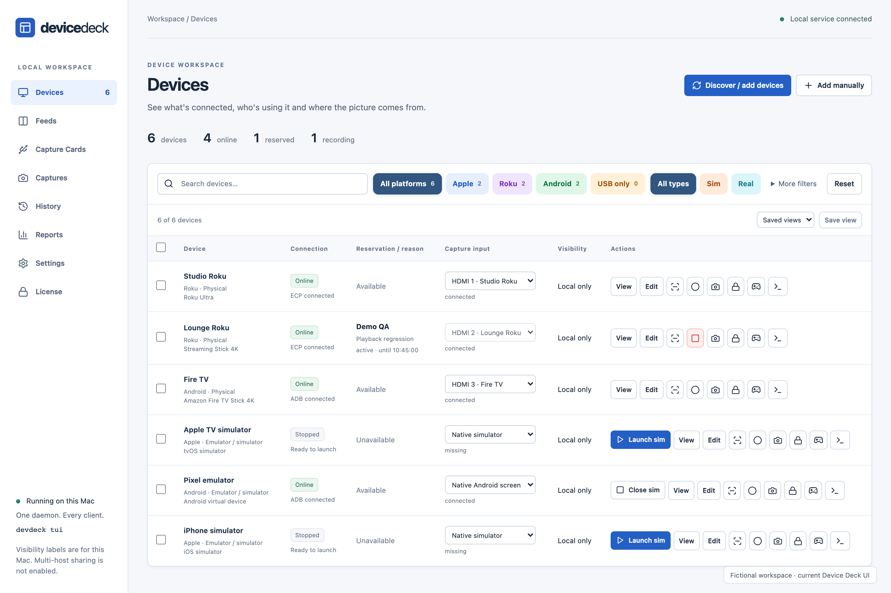

# Device Deck

**An open-source device workspace for you, your coding agents, and CI.**

Control TVs, phones and simulators from a Mac. See which devices are available, reserve them, watch their screens, and keep screenshots and recordings together. The dashboard, CLI, terminal UI and MCP server share the same inventory and reservations.

Free under the [MIT license](LICENSE). All features and concurrent sessions are available without activation, subscriptions or payment. Local use needs no Device Deck account.

[Download for Mac](https://tantawowa-device-deck.firebaseapp.com/install) · [Documentation](https://tantawowa-device-deck.firebaseapp.com/docs/) · [Website](https://tantawowa-device-deck.firebaseapp.com) · [Contribute](CONTRIBUTING.md)



*Current app interface with fictional demo devices. The website's separate browser demo is an earlier prototype and never connects to your hardware.*

## What you can do

- Find and control Roku, Android, Apple simulators and configured physical Apple devices. Watch native screens or paired USB/HDMI capture inputs.
- Reserve a device before sending input or recording. People, agents and CI jobs see the same ownership and availability.
- Save screenshots and silent recordings, add keypress annotations, and browse captures by device, name or tag.
- Reserve a complete device group for CI, start stopped virtual devices, and pass their serials or UDIDs to existing test runners. Release restores the virtual devices that the group started.
- Reach your Mac through Tailscale, or connect another Mac's Deck. Each host retains its device reservations and captures.

Capabilities and setup vary by device. Read the [compatibility guide](docs/compatibility.md) for implemented adapters, documented checks and limits.

## Install the Mac application

Requires macOS 14 or later. [Download Device Deck 0.9.0-beta.3 for Apple silicon or Intel](https://tantawowa-device-deck.firebaseapp.com/install). The signed, Apple-notarized installers include Node, FFmpeg, ffprobe and the dashboard. Normal installation and setup need no Terminal commands, Homebrew, restart or logout.

Open Device Deck from Applications, choose **Start shared service**, and approve the administrator prompt. The core service starts immediately and runs at boot; **Open menu-bar app at login** controls the menu app used for camera access. Allow existing Mac accounts, including CI runners, from **Mac setup… → Mac account access**.

Follow the [Mac setup walkthrough](https://tantawowa-device-deck.firebaseapp.com/docs/install/) for permissions, device tools and updates from the app. See the [beta.3 release notes](https://github.com/TantaWowa/device-deck/releases/tag/v0.9.0-beta.3) for validation results and beta limitations, or the [Mac distribution guide](https://tantawowa-device-deck.firebaseapp.com/docs/macos-distribution/) for packaging and service details. Older unsigned betas need the signed installer downloaded manually once.

## Your first device session

1. Open Device Deck and complete the setup for your release.
2. In **Devices → Discover / add devices**, select a ready device and choose **Add selected**. Check **Settings → Host diagnostics** if a required tool is missing.
3. Open its feed or remote. Reserve it with an owner label and reason before sending input. Physical Roku and Apple TV video needs a paired USB capture card.
4. Take a screenshot or make a short recording, then open the saved file in **Captures**.
5. Stop any recording and release the device when finished.

The [workspace guide](docs/using-device-deck.md) covers feeds, remotes, keyboard controls, captures, sharing and settings.

## Coding agents and CI

[Connect an MCP client](docs/api.md#mcp-walkthrough) to use the same device operations as the dashboard. Agents can inspect supported UI trees, read bounded logs, launch apps and save captures while holding a reservation. See [interactive agent work](docs/agent-device-workflow.md) for backend support.

For CI, [reserve a device group](docs/group-reservations.md) before a run and release it in unconditional cleanup. Existing XCTest and Android runners consume the returned device identifiers; they keep their own drivers and assertions.

The installed CLI also provides interactive and scriptable access:

```sh
devdeck devices --platform Android --state free --json
devdeck remote --device 'Desk TV' --reason 'Check playback controls'
devdeck tui
```

## Build from source

Requires macOS 14 or later, Node 24 or later, and Xcode command-line tools. From a checkout:

```sh
npm ci
npm run build:local
export DEVICE_DECK_HOME="$HOME/Library/Application Support/Device Deck Development"
export DEVICE_DECK_PORT=0
node build/devdeck.mjs init
node build/devdeck.mjs start
node build/devdeck.mjs ui
```

The explicit development profile keeps this run separate from an installed shared service. Platform tools and unbundled recording dependencies are described in [development setup](docs/development.md). Run `node build/devdeck.mjs stop` in the same environment when finished.

## Help and contribute

[Report a bug, suggest a feature, or share a tested device](https://github.com/TantaWowa/device-deck/issues/new/choose). Include your Device Deck version and the device or simulator involved. Remove credentials and private app data from diagnostics before posting them.

The [contribution guide](CONTRIBUTING.md) covers setup, focused checks and pull requests. Documentation corrections and reproducible hardware reports are useful contributions too. See the [architecture](docs/architecture.md) for module ownership and the [validation history](docs/validation.md) for the scope of recorded checks.

## License

Copyright 2026 TantaWowa. Device Deck source is MIT licensed. Third-party components retain their own licenses; release notices and bundled media sources identify them. See [source provenance](docs/source-provenance.md).
