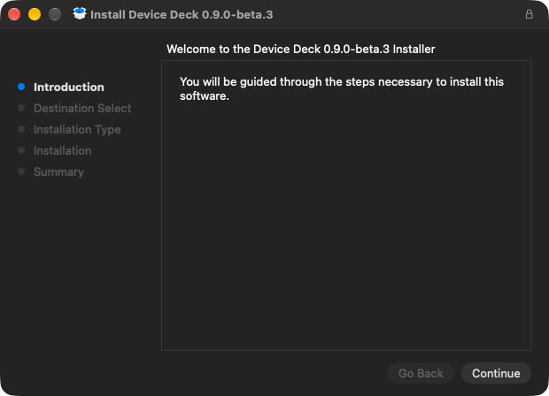
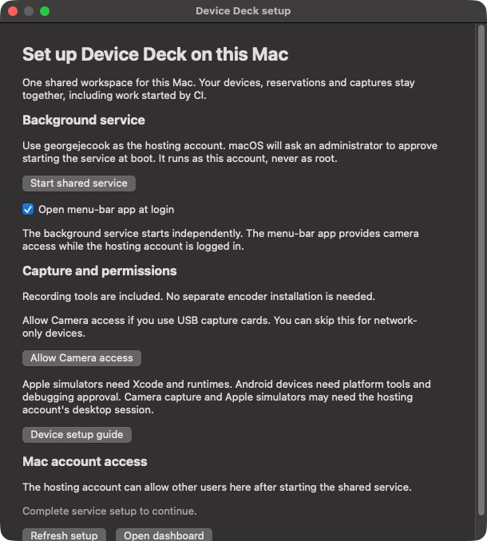

# Install Device Deck on your Mac

Install **Device Deck 0.9.0-beta.9** on an Apple silicon Mac running macOS 14 or later. The installer is signed and Apple-notarized, with Node, FFmpeg, ffprobe and the dashboard included. Normal installation and setup need no Terminal commands or Homebrew. You do not need to restart or log out.

Device Deck is free and open source under MIT. You do not need a Device Deck account or license key. See the [beta.9 release notes](https://github.com/TantaWowa/device-deck/releases/tag/v0.9.0-beta.9) for validation results and remaining beta limitations.

Want help from Codex or Claude? [Set up with an agent](agent-setup.md) gives you copyable prompts for this installation and for adding capture cards, devices and simulators.

## Install the Mac application

1. Download the [Apple silicon installer](https://github.com/TantaWowa/device-deck/releases/download/v0.9.0-beta.9/device-deck-0.9.0-beta.9-macos-arm64.pkg).
2. Open the downloaded `.pkg`, choose **Continue**, then follow the macOS installer through **Install** and administrator approval.
3. When installation finishes, open **Device Deck** from **Applications**.

If you are replacing an older beta, finish its sessions and recordings and quit the old app before installing. See [older unsigned betas](#older-unsigned-betas).

## Start the shared service

Complete setup while signed in as the Mac account that owns your devices, simulator runtimes, SDKs and pairing settings. On a personal Mac, this is usually your normal account. This account becomes the **host**; the setup screen cannot switch hosts later.

The setup screen before starting the shared service. Your Mac account name appears under **Background service**.

1. In **Set up Device Deck on this Mac**, check the hosting account named under **Background service**.
2. Choose **Start shared service** and approve the macOS administrator prompt. The service runs as the hosting account, never as root.
3. Keep **Open menu-bar app at login** selected, especially if you use USB capture cards.
4. For USB capture, choose **Allow Camera access** and approve the permission request. If access was denied previously, use **Open Camera settings**. You can skip Camera permission for network-only devices.
5. Scroll down if needed. When setup says **The shared service is ready.**, choose **Open dashboard**. Use **Refresh setup** if the screen has not updated.

You can reopen this screen from the menu-bar icon → **Mac setup…**.

The shared service starts at boot, after any required FileVault disk unlock. It keeps one inventory and reservation store for this Mac. Closing the dashboard or choosing **Quit menu-bar app** leaves the service running. **Open at login** in the menu controls only the menu-bar app.

USB capture needs the host signed in, its menu-bar app running and Camera permission allowed. Apple simulator features also need a usable host desktop. Boot startup makes the core service available before login; these desktop requirements still apply.

## Add your first device

In the dashboard, choose **Devices → Discover / add devices**, select a device and choose **Add selected**. Open its viewer and reserve it with your name and a reason. Follow [your first device session](using-device-deck.md#first-device-session) to control it, save a capture and release it.

Device Deck includes its recording tools. Install only the additional tools needed for your devices:

| Device or capability | Host setup |
| --- | --- |
| Roku control | Enable network control on a reachable Roku. |
| USB capture card | Allow Camera access in the host's desktop session. |
| Android or Fire TV | Install Android platform tools, enable debugging and accept device authorization. Emulators also need an SDK and configured AVD. |
| Apple simulator | Install Xcode and the required runtimes. Touch control needs the idb client and companion. |
| Physical iPhone or iPad | Follow [physical iOS setup](physical-ios.md) for WebDriverAgent and its helpers. |
| Physical Apple TV | Configure pyatv in the host account and pair the TV. |

Allow Local Network access when macOS requests it. **Settings → Host diagnostics** shows missing tools; the host can set custom executable paths in Settings. See [device compatibility](compatibility.md) for supported controls and capture methods.

## Allow another Mac account

1. Sign in as the host and open menu-bar icon → **Mac setup…**.
2. Under **Mac account access**, select each existing account that should use the devices, such as `ci-runner`.
3. Sign in to an allowed account and open Device Deck, or use the installed CLI or MCP server. It connects to the same service automatically.

Allowed accounts share reservations and captures without copied API tokens or another daemon. The host manages configuration, tool paths and account access. Clear an account's checkbox to revoke access.

Device operations use the host's SDKs and device permissions. This does not merge macOS simulator homes: CI jobs invoking native tools directly against a host-owned simulator must run those tools under the host account too.

## Update the Mac installation

Choose menu-bar icon → **Check for updates…**. When a newer signed release is available, choose **Download update**. After verification, choose **Install and reopen**, or **Install when idle** to wait for every account's reservations and recordings to finish.

Approve the administrator prompt to apply the update for everyone on the Mac. Device Deck stops and restarts the shared service and reopens menu-bar clients. Configuration and captures remain in place. Complete Mac setup before using this update flow.

## Older unsigned betas

Packages through `0.9.0-beta.2` are unsigned and use external FFmpeg and per-user login startup. Download the signed installer above manually once, finish sessions and recordings, quit the old app, then install and complete **Mac setup…**. Shared-service setup replaces the host's old Device Deck login-service registration.

An older licensed beta may still use its previous download service, so use the public download links above. For source builds, service paths, removal and remaining clean-Mac acceptance checks, see [Mac distribution](macos-distribution.md).
